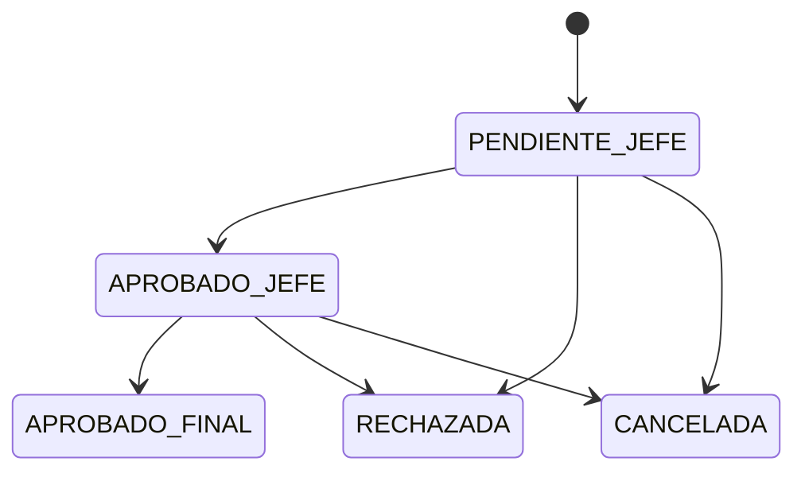

# API de vacaciones (ms-vacaciones)

Rutas públicas: `/api/vacaciones/*`; rutas internas ms-vacaciones: las mismas
sin `/api`. El servicio mantiene `EmpleadoRef` sin CI ni sueldo y verifica
localmente permisos, propiedad y firma interna en cada operación.

## Elegibilidad y saldo

Es elegible quien tiene estado `RATIFICADO` y al menos un año completo desde
`fechaIngreso`. Se asignan 15 días por gestión completada en el MVP, con
parámetros de `ConfiguracionVacaciones`; los días hábiles excluyen fines de
semana y feriados aplicables. El saldo pendiente por gestión es
`diasAsignados - diasTomados`. Nunca se descuenta saldo antes de la aprobación
final. Con dos gestiones pendientes se informa/bloquea con
`VAC_GESTION_BLOQUEADA`.

## Endpoints

| Método y ruta pública -> interna | Permiso | Propiedad / alcance | Body y validaciones | Respuesta | Errores | Auditoría |
|---|---|---|---|---|---|---|
| `GET /api/vacaciones/saldo` -> `GET /vacaciones/saldo` (propio) | `vacaciones:read_own` | Sin selector de tercero: solo `empleadoId` del token | Query paginada opcional para desgloses | `200 { empleadoId, elegible, gestiones: [{ gestion, diasAsignados, diasTomados, diasPendientes }] }` y advertencia `GESTION_BLOQUEADA` si corresponde | `FORBIDDEN`, `NOT_FOUND` | `VACACIONES_SALDO_CONSULTAR` |
| `GET /api/vacaciones/saldo?empleadoId=:id` -> mismo path (tercero) | `vacaciones:read_all` | Solo lectura global permitida por este permiso; no se acepta acceso ajeno por identidad manipulada | UUID y paginación opcional | Igual que saldo propio | `VALIDATION_ERROR`, `NOT_FOUND`, `FORBIDDEN` | `VACACIONES_SALDO_CONSULTAR` |
| `GET /api/vacaciones/saldo?areaId=:id` -> mismo path (área) | `vacaciones:read_area` | Área debe ser la propia del jefe según el estado local; otro ámbito responde 404 | UUID y paginación opcional | `200 { data: [{ empleadoId, elegible, gestiones }], meta }` | `VALIDATION_ERROR`, `NOT_FOUND`, `FORBIDDEN` | `VACACIONES_SALDO_AREA_CONSULTAR` |
| `POST /api/vacaciones/solicitudes` -> `POST /vacaciones/solicitudes` | `vacaciones:request` | Solo crea solicitud para `empleadoId` del token; `empleadoId` no se acepta del body | `{ fechaInicio, fechaFin, solicitarExcepcion?: boolean, justificacionExcepcion?: string }`; fechas ISO, inicio <= fin, elegibilidad, días hábiles > 0, no traslape con solicitudes/licencias. Si excede saldo, sin excepción responde `VAC_SALDO_INSUFICIENTE`; con `solicitarExcepcion=true`, requiere justificación y crea solicitud más excepción asociada en una transacción | `201 { id, empleadoId, fechaInicio, fechaFin, diasHabiles, estado: "PENDIENTE_JEFE", jefeEmpleadoId, excepcion? }` | `VALIDATION_ERROR`, `VAC_NO_ELEGIBLE`, `VAC_SALDO_INSUFICIENTE`, `VAC_TRASLAPE`, `VAC_GESTION_BLOQUEADA`, `FORBIDDEN` | `VACACION_SOLICITAR` |
| `GET /api/vacaciones/solicitudes?vista=propias` -> `GET /vacaciones/solicitudes` | `vacaciones:read_own` | Solo solicitudes del funcionario autenticado | `vista=propias`, filtros opcionales `estado`, `desde`, `hasta`, paginación | `200 { data, meta }` | `VALIDATION_ERROR`, `FORBIDDEN` | `VACACIONES_PROPIAS_LISTAR` |
| `GET /api/vacaciones/solicitudes?vista=bandeja-jefe` -> mismo path | `vacaciones:approve_jefe` | Solo solicitudes cuyo snapshot de jefe coincide y cuyo empleado pertenece al área del jefe actual | `vista=bandeja-jefe`, `estado?`, paginación | `200 { data, meta }` | `VALIDATION_ERROR`, `FORBIDDEN` | `VACACIONES_BANDEJA_JEFE_LISTAR` |
| `GET /api/vacaciones/solicitudes?vista=bandeja-rrhh` -> mismo path | `vacaciones:approve_rrhh` | Solicitudes `APROBADO_JEFE` de ámbito RRHH; nunca incluye solicitud propia para aprobación final | `vista=bandeja-rrhh`, filtros, paginación | `200 { data, meta }` | `VALIDATION_ERROR`, `FORBIDDEN` | `VACACIONES_BANDEJA_RRHH_LISTAR` |
| `GET /api/vacaciones/solicitudes/:id` -> `GET /vacaciones/solicitudes/:id` | `vacaciones:read_own`, `vacaciones:read_area` o `vacaciones:read_all`, según vista | Dueño, jefe de su área en bandeja, o lectura global; objeto ajeno siempre 404 | UUID | `200` solicitud, historial y excepción asociada si existe | `NOT_FOUND`, `FORBIDDEN` | `VACACION_CONSULTAR` |
| `POST /api/vacaciones/solicitudes/:id/aprobar-jefe` -> `POST /vacaciones/solicitudes/:id/aprobar-jefe` | `vacaciones:approve_jefe` | Actor debe ser jefe actual de esa área; empleado solicitante distinto del actor; estado `PENDIENTE_JEFE` | `{ comentario?: string }`; solo campos incluidos en whitelist | `200 { id, estado: "APROBADO_JEFE", aprobadoJefePor, aprobadoJefeEn }` | `VALIDATION_ERROR`, `NOT_FOUND`, `VAC_AUTOAPROBACION`, `VAC_ESTADO_INVALIDO`, `FORBIDDEN` | `VACACION_APROBAR_JEFE` |
| `POST /api/vacaciones/solicitudes/:id/aprobar-rrhh` -> `POST /vacaciones/solicitudes/:id/aprobar-rrhh` | `vacaciones:approve_rrhh` | Solo `APROBADO_JEFE`; el aprobador no es el solicitante; no puede resolver su propia solicitud | `{ comentario?: string }` | `200 { id, estado: "APROBADO_FINAL", aprobadoRrhhPor, aprobadoRrhhEn, descuentos }`; el descuento se registra atómicamente ahora y no antes | `VALIDATION_ERROR`, `NOT_FOUND`, `VAC_AUTOAPROBACION`, `VAC_ESTADO_INVALIDO`, `VAC_SALDO_INSUFICIENTE`, `FORBIDDEN` | `VACACION_APROBAR_RRHH` |
| `POST /api/vacaciones/solicitudes/:id/rechazar` -> `POST /vacaciones/solicitudes/:id/rechazar` (nivel jefe) | `vacaciones:approve_jefe` | Solo jefe del área del empleado, solicitud `PENDIENTE_JEFE`, actor distinto del solicitante | `{ motivo: string }`; obligatorio y no vacío | `200 { id, estado: "RECHAZADA" }` | `VALIDATION_ERROR`, `NOT_FOUND`, `VAC_AUTOAPROBACION`, `VAC_ESTADO_INVALIDO`, `FORBIDDEN` | `VACACION_RECHAZAR_JEFE` |
| `POST /api/vacaciones/solicitudes/:id/rechazar` -> mismo path (nivel RRHH) | `vacaciones:approve_rrhh` | Solo RRHH sobre `APROBADO_JEFE`; actor distinto del solicitante | `{ motivo: string }`; obligatorio y no vacío | `200 { id, estado: "RECHAZADA" }` | `VALIDATION_ERROR`, `NOT_FOUND`, `VAC_AUTOAPROBACION`, `VAC_ESTADO_INVALIDO`, `FORBIDDEN` | `VACACION_RECHAZAR_RRHH` |
| `POST /api/vacaciones/solicitudes/:id/cancelar` -> `POST /vacaciones/solicitudes/:id/cancelar` | `vacaciones:request` | Solo dueño; solo antes de `APROBADO_FINAL` | `{ motivo?: string }`; no se acepta `empleadoId` del cliente | `200 { id, estado: "CANCELADA" }` | `NOT_FOUND`, `VAC_ESTADO_INVALIDO`, `FORBIDDEN` | `VACACION_CANCELAR` |
| `POST /api/vacaciones/solicitudes/:id/excepcion` -> `POST /vacaciones/solicitudes/:id/excepcion` | `vacaciones:request` | Solo dueño de solicitud; una excepción por solicitud según unique del esquema | `{ justificacion: string }`; obligatorio; exceso se calcula en servicio | `201 { id, solicitudId, diasExcedentes, estado: "PENDIENTE" }` | `VALIDATION_ERROR`, `NOT_FOUND`, `CONFLICT`, `FORBIDDEN` | `VACACION_EXCEPCION_SOLICITAR` |
| `POST /api/vacaciones/excepciones/:id/resolver` -> `POST /vacaciones/excepciones/:id/resolver` | `vacaciones:excepcion_resolve` | Actor distinto del solicitante; excepción pendiente; nunca resuelve un caso propio aunque tenga permiso | `{ decision: "APROBADA" \| "RECHAZADA", comentario?: string }`; actor, fecha y estado se asignan en servicio | `200 { id, estado, resueltoPor, resueltoEn }` | `VALIDATION_ERROR`, `NOT_FOUND`, `VAC_AUTOAPROBACION`, `VAC_EXCEPCION_ESTADO_INVALIDO`, `FORBIDDEN` | `VACACION_EXCEPCION_RESOLVER` |
| `GET /api/vacaciones/licencias` -> `GET /licencias` | `licencias:manage` | Ámbito de gestión autorizado; expediente ajeno/área ajena no se revela | Query `empleadoId?`, `estado?`, `tipo?`, rango y paginación | `200 { data, meta }` | `VALIDATION_ERROR`, `NOT_FOUND`, `FORBIDDEN` | `LICENCIAS_LISTAR` |
| `POST /api/vacaciones/licencias` -> `POST /licencias` | `licencias:manage` | Gestiona licencia del empleado indicado; valida acceso a su `EmpleadoRef` | `{ empleadoId, tipo, fechaInicio, fechaFin, respaldo? }`; tipo del enum; inicio <= fin; sin traslape con solicitud/licencia; respaldo conforme política de adjuntos | `201 { id, empleadoId, tipo, fechaInicio, fechaFin, estado: "PENDIENTE" }` | `VALIDATION_ERROR`, `VAC_TRASLAPE`, `NOT_FOUND`, `FORBIDDEN` | `LICENCIA_REGISTRAR` |
| `POST /api/vacaciones/licencias/:id/autorizar` -> `POST /licencias/:id/autorizar` | `licencias:manage` | Solo licencia pendiente y dentro del ámbito del actor | `{ comentario?: string }` | `200 { id, estado: "AUTORIZADA", autorizadoPor }` | `NOT_FOUND`, `VAC_ESTADO_INVALIDO`, `FORBIDDEN` | `LICENCIA_AUTORIZAR` |
| `POST /api/vacaciones/licencias/:id/rechazar` -> `POST /licencias/:id/rechazar` | `licencias:manage` | Solo licencia pendiente y dentro del ámbito del actor | `{ motivo: string }` | `200 { id, estado: "RECHAZADA" }` | `VALIDATION_ERROR`, `NOT_FOUND`, `VAC_ESTADO_INVALIDO`, `FORBIDDEN` | `LICENCIA_RECHAZAR` |
| `GET /api/vacaciones/feriados` -> `GET /feriados` | `vacaciones:config` | Solo consulta del catálogo del servicio | Query `desde?`, `hasta?`, `ambito?`, `departamento?`, paginación | `200 { data, meta }` | `VALIDATION_ERROR`, `FORBIDDEN` | `FERIADOS_LISTAR` |
| `POST /api/vacaciones/feriados` -> `POST /feriados` | `vacaciones:config` | Crea feriado dentro del catálogo | `{ fecha, nombre, ambito: "NACIONAL" \| "DEPARTAMENTAL", departamento? }`; fecha válida; departamento requerido para departamental | `201 { id, fecha, nombre, ambito, departamento }` | `VALIDATION_ERROR`, `CONFLICT`, `FORBIDDEN` | `FERIADO_CREAR` |
| `PATCH /api/vacaciones/feriados/:id` -> `PATCH /feriados/:id` | `vacaciones:config` | Solo feriado indicado | `{ fecha?, nombre?, ambito?, departamento? }`; whitelist, validar unique compuesto | `200` feriado actualizado | `VALIDATION_ERROR`, `NOT_FOUND`, `CONFLICT`, `FORBIDDEN` | `FERIADO_ACTUALIZAR` |
| `DELETE /api/vacaciones/feriados/:id` -> `DELETE /feriados/:id` | `vacaciones:config` | Solo feriado indicado | Sin body | `204` | `NOT_FOUND`, `FORBIDDEN` | `FERIADO_ELIMINAR` |
| `GET /api/vacaciones/configuracion` -> `GET /configuracion` | `vacaciones:config` | Lectura de configuración del servicio | Sin body | `200 { data: [{ clave, valor, actualizadoEn }] }` | `FORBIDDEN` | `VACACIONES_CONFIG_CONSULTAR` |
| `PATCH /api/vacaciones/configuracion/:clave` -> `PATCH /configuracion/:clave` | `vacaciones:config` | Modifica solo claves autorizadas | `{ valor: string }`; whitelist: `DIAS_POR_GESTION`, `MAX_GESTIONES_ACUMULADAS`, `MODO_ESCALA` (`MVP`/`LGT`) | `200 { clave, valor, actualizadoEn }` | `VALIDATION_ERROR`, `NOT_FOUND`, `FORBIDDEN` | `VACACIONES_CONFIG_ACTUALIZAR` |
| `GET /api/vacaciones/calendario` -> `GET /calendario` | `vacaciones:read_own`, `vacaciones:read_area` o `vacaciones:read_all`, según selector | Propio sin selector; área solo del jefe; empresa solo con lectura global | `empleadoId?`, `areaId?`, `desde`, `hasta`, paginación; solo un selector | `200 { data: [{ fechaInicio, fechaFin, tipo, estado, empleadoId? }], meta }`; identidad minimizada según permiso | `VALIDATION_ERROR`, `NOT_FOUND`, `FORBIDDEN` | `VACACIONES_CALENDARIO_CONSULTAR` |

Todas las transiciones agregan `HistorialSolicitud` en la misma transacción del
cambio de estado. Nadie aprueba ni resuelve su propia solicitud. Mensajes y
estados de error siguen [errores.md](./errores.md).

## Flujo de estados

La excepción es un flujo asociado, con estado `PENDIENTE`, `APROBADA` o
`RECHAZADA`; resolverla no equivale a aprobación de vacaciones. Al recibir
empleado/área se aplica además la regla de jefatura declarada en Supuestos del
README. Si la solicitud está fuera de propiedad, se responde 404.

## Feriados, licencias y datos de empleado

ms-vacaciones deriva elegibilidad y jefatura de `EmpleadoRef`; no consulta la
base de ms-personal. Los feriados nacionales y departamentales se descuentan
del cálculo hábil. Solicitudes y licencias que se cruzan se rechazan como
`VAC_TRASLAPE`. El descuento de saldo ocurre solo al pasar a `APROBADO_FINAL`.
Dos gestiones pendientes generan `VAC_GESTION_BLOQUEADA`.
