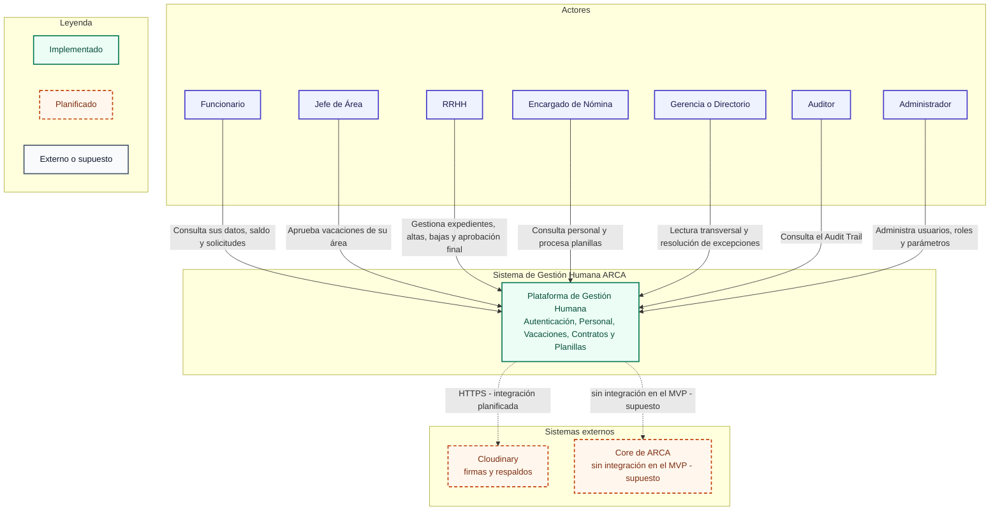

# C4 nivel 1 - Contexto del Sistema de Gestión Humana

Este diagrama sitúa el Sistema de Gestión Humana de ARCA Ltda. frente a sus
actores y sistemas externos. Los actores corresponden a los siete roles del
seed de `ms-auth`: Funcionario, Jefe de Área, RRHH, Encargado de Nómina,
Gerencia o Directorio, Auditor y Administrador. El sistema agrupa autenticación,
personal, vacaciones, contratos y planillas. El Core de ARCA es externo y no
tiene integración en el MVP. Cloudinary se usa para firmas y respaldos, pero su
integración está planificada y hoy solo existe configuración de entorno.

## Diagrama

## Decisiones relacionadas

- [ADR-001 - Microservicios y arquitectura hexagonal](../adr/ADR-001-microservicios-y-hexagonal.md)
- [ADR-002 - Mensajería con RabbitMQ y Outbox](../adr/ADR-002-mensajeria.md)
- [ADR-003 - Autenticación, RBAC y auditoría](../adr/ADR-003-autenticacion-rbac-auditoria.md)
- [ADR-004 - Reglas de vacaciones e inamovilidad](../adr/ADR-004-reglas-de-vacaciones-e-inamovilidad.md)
- [ADR-005 - TLS en tránsito](../adr/ADR-005-tls-en-transito.md)
- [ADR-006 - Protección de datos sensibles](../adr/ADR-006-proteccion-de-datos-sensibles.md)

## Estado

**Implementado:** el esqueleto de los cinco servicios, el frontend, el API
Gateway, PostgreSQL con una base por servicio, RabbitMQ y los siete roles del
seed de autenticación.

**Planificado:** la integración con Cloudinary para firmas y respaldos. El Core
de ARCA no tiene integración en el MVP; se mantiene como supuesto y cualquier
sincronización futura requiere una decisión arquitectónica propia.

**Leyenda:** el trazo continuo verde representa lo implementado; el trazo
punteado naranja, lo planificado; el gris, un sistema externo o un supuesto.
