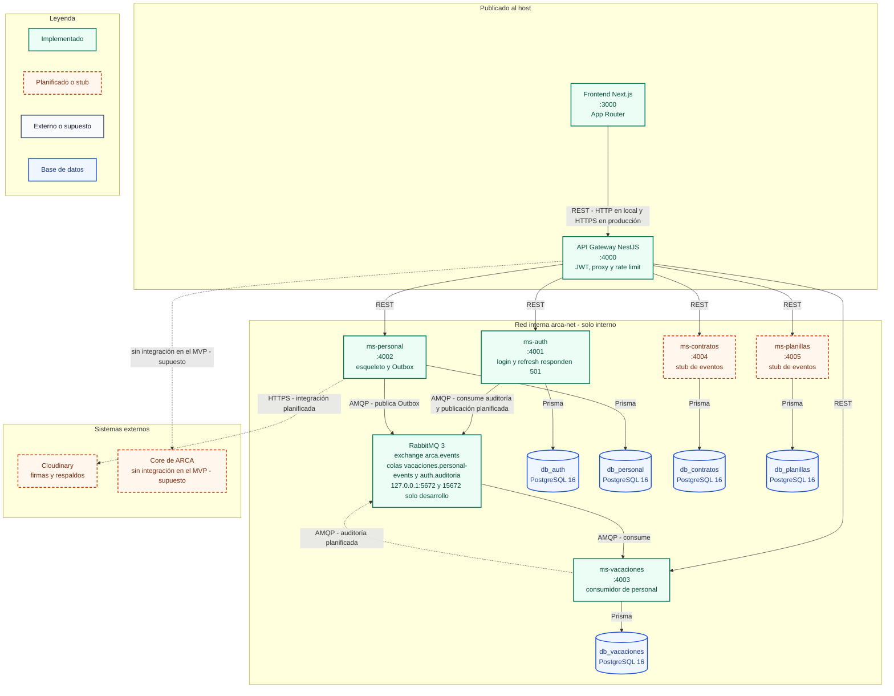

# C4 nivel 2 - Contenedores

Este diagrama muestra los contenedores desplegables y su ubicación de red. Solo
el frontend Next.js en 3000 y el API Gateway en 4000 se publican al host. Los
cinco microservicios en 4001 a 4005 y sus bases PostgreSQL son internos a
`arca-net`; PostgreSQL y RabbitMQ se exponen solo en loopback para desarrollo.
Todo acceso externo entra por el gateway con REST y el prefijo `/api`. La
integración entre servicios es asíncrona con AMQP sobre `arca.events`.
`ms-contratos` y `ms-planillas` siguen como stubs. Cloudinary está planificado y
el Core de ARCA no se integra en el MVP.

## Diagrama

## Decisiones relacionadas

- [ADR-001 - Microservicios y arquitectura hexagonal](../adr/ADR-001-microservicios-y-hexagonal.md)
- [ADR-002 - Mensajería con RabbitMQ y Outbox](../adr/ADR-002-mensajeria.md)
- [ADR-003 - Autenticación, RBAC y auditoría](../adr/ADR-003-autenticacion-rbac-auditoria.md)
- [ADR-005 - TLS en tránsito](../adr/ADR-005-tls-en-transito.md)
- [ADR-006 - Protección de datos sensibles](../adr/ADR-006-proteccion-de-datos-sensibles.md)
- [ADR-007 - Privilegios mínimos y refuerzos de BD](../adr/ADR-007-privilegios-minimos-y-refuerzos-de-bd.md)

## Estado

**Implementado:** frontend y gateway publicados en 3000 y 4000; los cinco
servicios y sus cinco bases en la red interna; exchange `arca.events`, colas
durables, reintentos y DLQ; publicador Outbox en `ms-personal`; consumidores de
`ms-vacaciones` y `ms-auth`.

**Planificado:** la lógica de negocio de los cinco servicios, la firma HMAC de
cabeceras internas, la verificación efectiva de permisos, la integración con
Cloudinary y la integración con el Core de ARCA. `ms-contratos` y
`ms-planillas` solo tienen los modelos `EventoProcesado` y `OutboxEvento`.

**Publicación al host:** solo `web-frontend:3000` y `api-gateway:4000`.
PostgreSQL en `127.0.0.1:5432` y RabbitMQ en `127.0.0.1:5672` y `15672` son
puertos de desarrollo en loopback, no exposición pública de los servicios.
