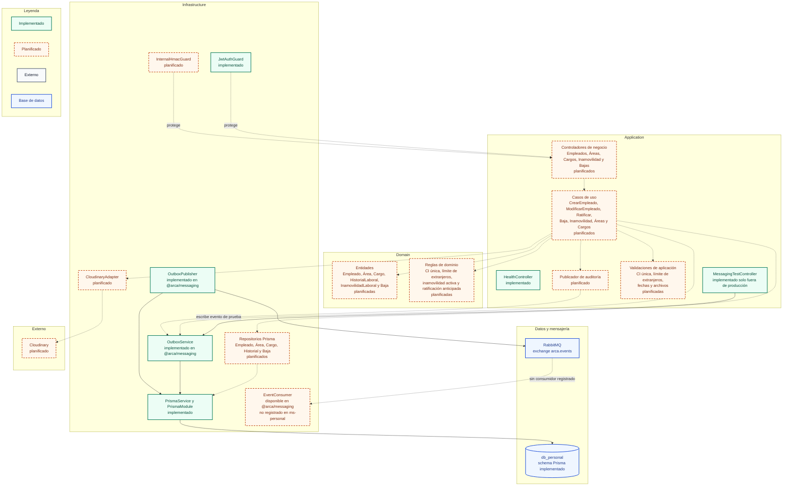

# C4 nivel 3 - Componentes de ms-personal

Este diagrama descompone `ms-personal` en las capas de la arquitectura hexagonal
ligera. La infraestructura ya contiene Prisma, el guard JWT, `OutboxService` y
`OutboxPublisher` de `@arca/messaging`. La aplicación solo tiene salud y el
controlador de prueba de eventos, disponible fuera de producción. Los
controladores de negocio, casos de uso, entidades y reglas de CI, extranjeros,
inamovilidad y ratificación están planificados. El adaptador de Cloudinary
también está planificado. `ms-personal` no registra consumidores en el Sprint 1;
la idempotencia de `@arca/messaging` se usa en `ms-vacaciones` y `ms-auth`.

## Diagrama

## Decisiones relacionadas

- [ADR-001 - Microservicios y arquitectura hexagonal](../adr/ADR-001-microservicios-y-hexagonal.md)
- [ADR-002 - Mensajería con RabbitMQ y Outbox](../adr/ADR-002-mensajeria.md)
- [ADR-003 - Autenticación, RBAC y auditoría](../adr/ADR-003-autenticacion-rbac-auditoria.md)
- [ADR-006 - Protección de datos sensibles](../adr/ADR-006-proteccion-de-datos-sensibles.md)
- [ADR-007 - Privilegios mínimos y refuerzos de BD](../adr/ADR-007-privilegios-minimos-y-refuerzos-de-bd.md)

## Estado

**Implementado:** `PrismaService`, `PrismaModule`, el esquema `db_personal`,
`JwtAuthGuard`, `HealthController`, `MessagingTestController` no productivo,
`OutboxService` y `OutboxPublisher` con publicación habilitada. El cifrado
AES-256-GCM y el HMAC de CI están disponibles en `@arca/crypto-utils`.

**Planificado:** controladores y casos de uso de negocio, entidades y reglas
de dominio, repositorios Prisma de negocio, `InternalHmacGuard`, adaptador de
Cloudinary y publicador de auditoría. La lógica de alta, modificación,
ratificación, baja e inamovilidad no existe todavía.

**Consumidores:** `ms-personal` no registra consumidores en el Sprint 1. La
idempotencia con `EventoProcesado` se documenta en el diagrama de
`ms-vacaciones` y en el consumidor de auditoría de `ms-auth`.
