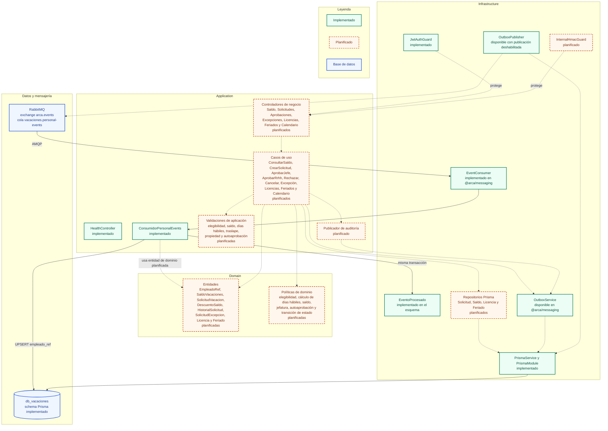

# C4 nivel 3 - Componentes de ms-vacaciones

Este diagrama descompone `ms-vacaciones` en las capas de la arquitectura
hexagonal ligera. La infraestructura ya tiene Prisma, el guard JWT, el
`EventConsumer` de `@arca/messaging` y `consumePersonalEvent`, que inserta
`EventoProcesado` y actualiza `EmpleadoRef` en una sola transacción. La
aplicación solo tiene salud y ese consumidor; los controladores, casos de uso y
reglas de saldo, elegibilidad, días hábiles, jefatura y transiciones están
planificados. `OutboxService` y `OutboxPublisher` existen, pero la publicación
está deshabilitada; elegibilidad y saldos son de TSK-VAC-101 y siguen planificados.

## Diagrama

## Decisiones relacionadas

- [ADR-001 - Microservicios y arquitectura hexagonal](../adr/ADR-001-microservicios-y-hexagonal.md)
- [ADR-002 - Mensajería con RabbitMQ y Outbox](../adr/ADR-002-mensajeria.md)
- [ADR-003 - Autenticación, RBAC y auditoría](../adr/ADR-003-autenticacion-rbac-auditoria.md)
- [ADR-004 - Reglas de vacaciones e inamovilidad](../adr/ADR-004-reglas-de-vacaciones-e-inamovilidad.md)
- [ADR-006 - Protección de datos sensibles](../adr/ADR-006-proteccion-de-datos-sensibles.md)
- [ADR-007 - Privilegios mínimos y refuerzos de BD](../adr/ADR-007-privilegios-minimos-y-refuerzos-de-bd.md)

## Estado

**Implementado:** `PrismaService`, `PrismaModule`, el esquema `db_vacaciones`,
`JwtAuthGuard`, `HealthController`, `EventConsumer`, `consumePersonalEvent` y
`EventoProcesado`. El consumidor actualiza `EmpleadoRef` con `ultimoEventoEn` y
no crea saldos ni calcula elegibilidad.

**Planificado:** controladores y casos de uso de negocio, entidades y políticas
de dominio, repositorios Prisma de negocio, `InternalHmacGuard`, publicación
Outbox de auditoría y el cálculo de elegibilidad y saldos de TSK-VAC-101. La
aprobación final atómica con `updateMany` y `descuento_saldo` está especificada
en [docs/api/vacaciones.md](../api/vacaciones.md), pero no implementada.

**Idempotencia:** `EventConsumer` inserta `EventoProcesado` y ejecuta el
handler en la misma transacción. Un `eventId` repetido se confirma sin repetir
el efecto. `EmpleadoRef` descarta eventos con `occurredOn` anterior a
`ultimo_evento_en`.
