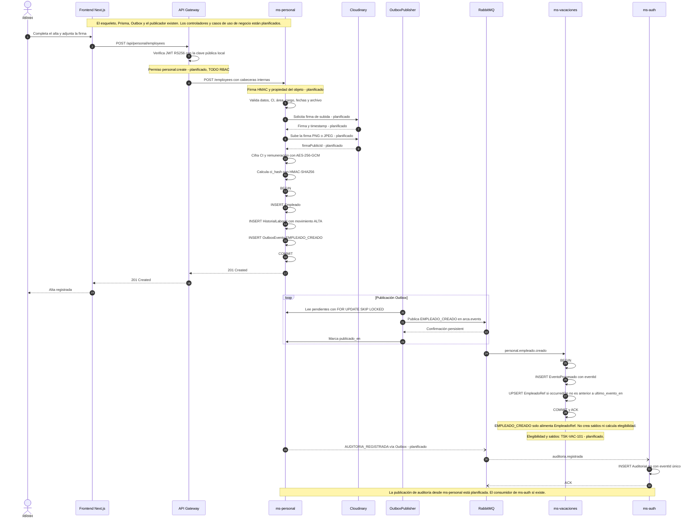

# Secuencia - Alta de funcionario

Esta secuencia describe el alta de un funcionario desde RRHH hasta la copia
local de `ms-vacaciones`. El gateway verifica el JWT y debe exigir
`personal:create`; `ms-personal` valida, firma la subida a Cloudinary, cifra CI
y remuneración y calcula `ci_hash`. En una sola transacción escribe `Empleado`,
`HistorialLaboral` y `OutboxEvento`. El publicador lee el Outbox y publica
`EMPLEADO_CREADO` en `arca.events`. `ms-vacaciones` inserta `EventoProcesado` y
hace upsert de `EmpleadoRef`; no crea saldos ni calcula elegibilidad. Esa lógica
es de TSK-VAC-101 y está planificada, igual que la auditoría a `ms-auth`.

## Diagrama

## Decisiones relacionadas

- [ADR-002 - Mensajería con RabbitMQ y Outbox](../adr/ADR-002-mensajeria.md)
- [ADR-003 - Autenticación, RBAC y auditoría](../adr/ADR-003-autenticacion-rbac-auditoria.md)
- [ADR-006 - Protección de datos sensibles](../adr/ADR-006-proteccion-de-datos-sensibles.md)
- [ADR-007 - Privilegios mínimos y refuerzos de BD](../adr/ADR-007-privilegios-minimos-y-refuerzos-de-bd.md)

## Estado

**Implementado:** verificación JWT en gateway y servicios, esquema
`db_personal`, cifrado AES-256-GCM y HMAC de `@arca/crypto-utils`,
`OutboxService`, `OutboxPublisher`, `EventConsumer`, `EventoProcesado`, el
consumidor `consumePersonalEvent` y el consumidor de auditoría de `ms-auth`.

**Planificado:** controlador y caso de uso de alta, validaciones de negocio,
firma y carga a Cloudinary, permiso efectivo `personal:create`, firma HMAC de
cabeceras internas, publicación de `AUDITORIA_REGISTRADA` desde `ms-personal`
y cálculo de elegibilidad y saldos de TSK-VAC-101. Hoy `Cloudinary` solo tiene
variables de entorno, no cliente ni llamadas.

**Leyenda:** los pasos con la marca `planificado` no existen todavía en el
código; los demás se apoyan en código o esquema actual. La validación visual
de este diagrama se hará en mermaid.live.
