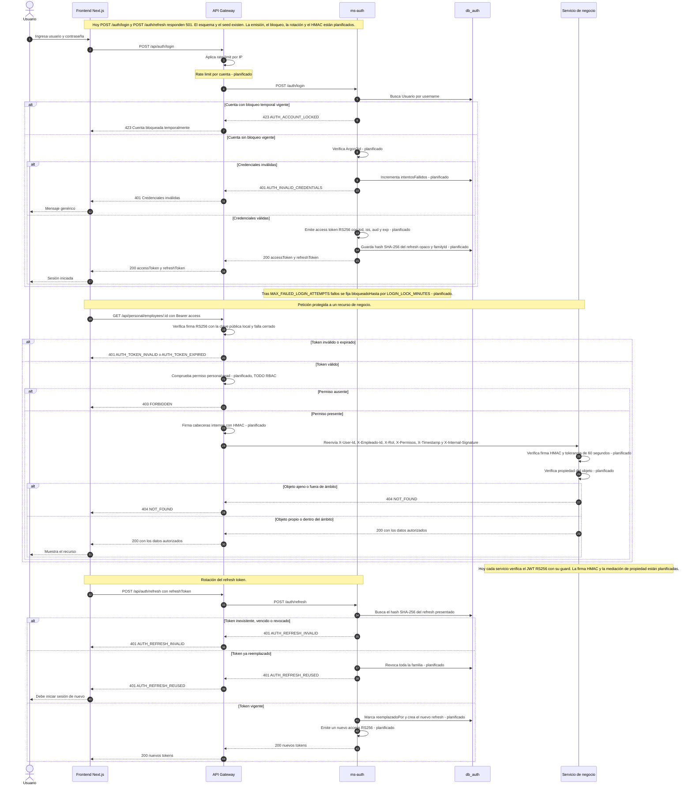

# Secuencia - Autenticación, acceso y refresh

Esta secuencia reúne el login, una petición protegida y la rotación del refresh
token. El login aplica rate limiting, verificación Argon2id y bloqueo temporal;
emite un access RS256 y un refresh opaco guardado como hash. En una petición
protegida, el gateway verifica el JWT con la clave pública local y falla cerrado,
comprueba el permiso y firma las cabeceras internas; el servicio verifica la
firma y la propiedad del objeto. El refresh rota y detecta el reuso revocando la
familia. Hoy login y refresh responden 501; la emisión, el bloqueo, la rotación
y el HMAC están planificados.

## Diagrama

## Decisiones relacionadas

- [ADR-002 - Mensajería con RabbitMQ y Outbox](../adr/ADR-002-mensajeria.md)
- [ADR-003 - Autenticación, RBAC y auditoría](../adr/ADR-003-autenticacion-rbac-auditoria.md)
- [ADR-005 - TLS en tránsito](../adr/ADR-005-tls-en-transito.md)
- [ADR-006 - Protección de datos sensibles](../adr/ADR-006-proteccion-de-datos-sensibles.md)
- [ADR-007 - Privilegios mínimos y refuerzos de BD](../adr/ADR-007-privilegios-minimos-y-refuerzos-de-bd.md)

## Estado

**Implementado:** `JwtAuthGuard` y verificación RS256 en gateway y servicios;
rate limit global por IP con `@nestjs/throttler`; esquema `db_auth` con
`Usuario`, `Rol`, `Permiso`, `RefreshToken` y `AuditoriaLog`; seed de siete
roles y 38 permisos; auditoría inmutable con `REVOKE` y triggers.

**Planificado:** `POST /auth/login` y `POST /auth/refresh` responden 501;
faltan Argon2id en login, bloqueo temporal por intentos, emisión RS256 con
`kid`, refresh opaco con hash, rotación, detección de reuso y revocación de
familia. También faltan rate limit por cuenta, verificación efectiva de
permisos, firma HMAC de cabeceras internas, tolerancia de 60 segundos y
mediación de propiedad en todos los servicios.

**Leyenda:** los pasos con la marca `planificado` no existen todavía en el
código; los demás se apoyan en el esquema o en componentes actuales. La
validación visual de este diagrama se hará en mermaid.live.
