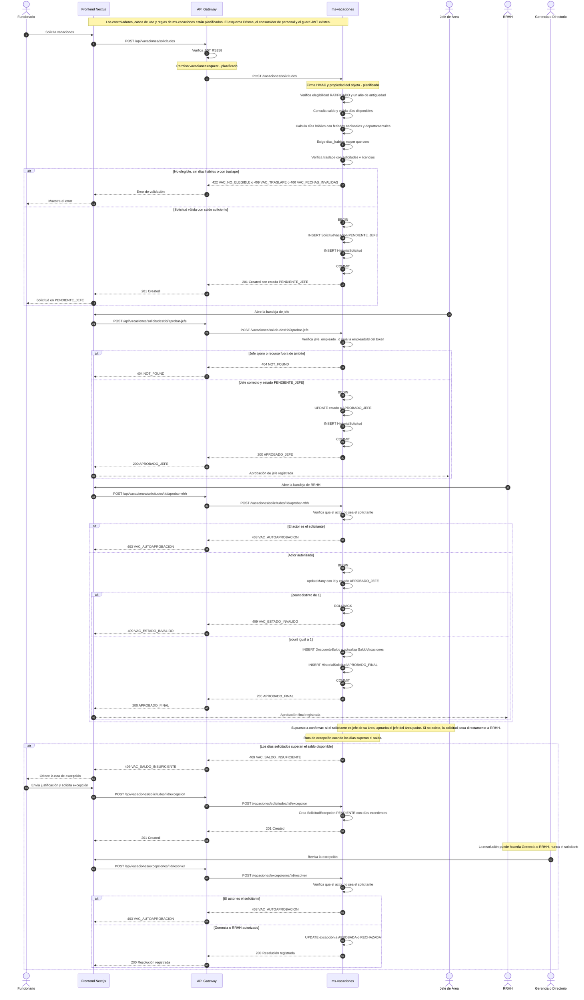

# Secuencia - Solicitud y aprobación de vacaciones

Esta secuencia cubre el ciclo de una solicitud de vacaciones con dos niveles de
aprobación. Al crear la solicitud, `ms-vacaciones` valida elegibilidad, saldo,
días hábiles con feriados, traslape y que `dias_habiles` sea mayor que cero.
La solicitud nace en `PENDIENTE_JEFE`; el jefe la pasa a `APROBADO_JEFE` y RRHH
la cierra en `APROBADO_FINAL` con una transacción que usa `updateMany`
condicionado al estado y escribe `descuento_saldo`. La excepción se activa
cuando los días superan el saldo y solo la resuelve Gerencia o RRHH, nunca el
solicitante. La regla del jefe del área padre es un supuesto y el flujo está planificado.

## Diagrama

## Decisiones relacionadas

- [ADR-002 - Mensajería con RabbitMQ y Outbox](../adr/ADR-002-mensajeria.md)
- [ADR-003 - Autenticación, RBAC y auditoría](../adr/ADR-003-autenticacion-rbac-auditoria.md)
- [ADR-004 - Reglas de vacaciones e inamovilidad](../adr/ADR-004-reglas-de-vacaciones-e-inamovilidad.md)
- [ADR-006 - Protección de datos sensibles](../adr/ADR-006-proteccion-de-datos-sensibles.md)
- [ADR-007 - Privilegios mínimos y refuerzos de BD](../adr/ADR-007-privilegios-minimos-y-refuerzos-de-bd.md)

## Estado

**Implementado:** esquema `db_vacaciones` con estados, saldos, descuentos,
historial, excepciones, licencias, feriados y configuración; `EventConsumer` y
`EventoProcesado`; guard JWT en el servicio.

**Planificado:** todos los controladores y casos de uso de solicitud,
aprobación, rechazo, cancelación, excepción, licencias, feriados y calendario;
las políticas de elegibilidad, días hábiles, saldo, jefatura y autoaprobación;
la transacción final con `updateMany` y `descuento_saldo`; el permiso efectivo
en gateway y servicio; y la firma HMAC de cabeceras internas.

**Supuesto:** la aprobación del jefe del área padre cuando el solicitante es
jefe de su propia área. Si no existe área padre, la solicitud pasa a RRHH.

**Leyenda:** los pasos con la marca `planificado` no existen todavía en el
código; los demás se apoyan en el esquema o en componentes actuales. La
validación visual de este diagrama se hará en mermaid.live.
